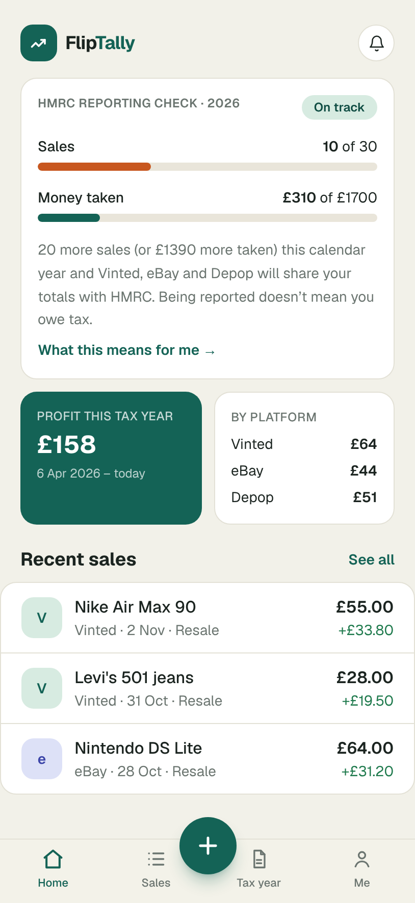
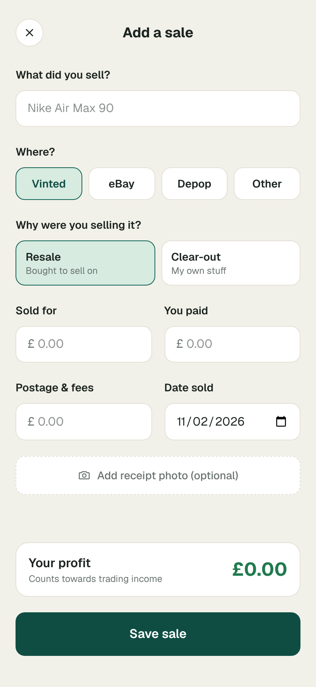
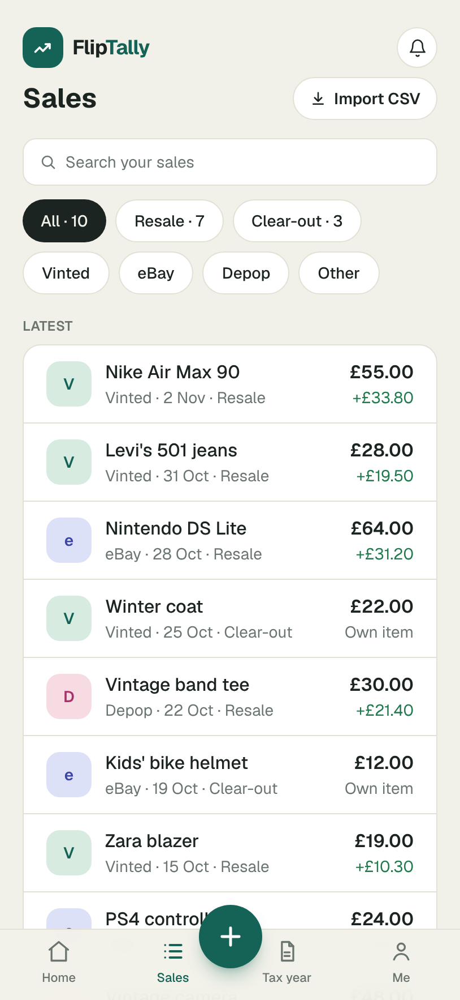
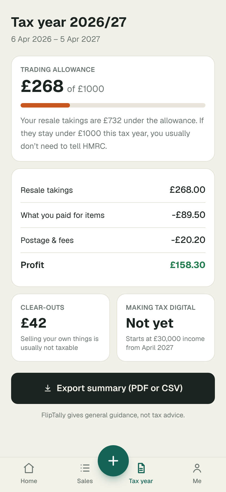

# FlipTally

Track your sales, costs and profit on Vinted, eBay, Depop and similar sites — and see
where you stand with HMRC's reporting thresholds before you reach them.

**v0.0.0-beta** · designed by [Lifespan Software](https://lifespansoftware.com) · see
[`CHANGELOG.md`](./CHANGELOG.md) or `/changelog` in the app, and
[`ROADMAP.md`](./ROADMAP.md) for what's planned next.

FlipTally gives general guidance, not tax advice, and isn't affiliated with Vinted, eBay,
Depop or HMRC.

## Screenshots

<table>
  <tr>
    <td align="center" width="25%">
      
      <br /><sub>Home</sub>
    </td>
    <td align="center" width="25%">
      
      <br /><sub>Add a sale</sub>
    </td>
    <td align="center" width="25%">
      
      <br /><sub>Sales</sub>
    </td>
    <td align="center" width="25%">
      
      <br /><sub>Tax year</sub>
    </td>
  </tr>
</table>

In-app, the **Me → Help** tab walks through every screen with the same screenshots — see
[`src/app/help/page.tsx`](./src/app/help/page.tsx) or visit `/help` once the app is
running.

## Stack

- [Next.js 16](https://nextjs.org) (App Router, TypeScript, Tailwind CSS v4)
- [Prisma](https://www.prisma.io) + SQLite — single-file database, no external DB needed
- `pdfkit` / `csv-parse` / `csv-stringify` for tax-year exports and CSV import

It's a single-user, self-hosted app: your data lives in one SQLite file on disk (or on a
Docker volume), with no third-party accounts required.

## Local development

```bash
npm install
cp .env.example .env
npx prisma migrate dev
npm run dev
```

The app runs at `http://localhost:3000`.

### Environment variables

| Variable             | Required | Description                                                                 |
| --------------------- | -------- | ---------------------------------------------------------------------------- |
| `DATABASE_URL`        | yes      | SQLite connection string, e.g. `file:./dev.db` or `file:/data/fliptally.db` |
| `FLIPTALLY_PASSCODE`  | no       | If set, gates the whole app behind a single shared passcode screen.         |

## Deploying

### Docker

```bash
docker build -t fliptally .
docker run -d \
  --name fliptally \
  -p 3000:3000 \
  -e FLIPTALLY_PASSCODE=changeme \
  -v fliptally_data:/data \
  fliptally
```

The container applies pending Prisma migrations on startup, then serves the app on port
`3000`. The SQLite database lives at `/data/fliptally.db` — mount a volume there so data
survives redeploys.

`docker-compose.yml` wraps the same thing for local testing:

```bash
FLIPTALLY_PASSCODE=changeme docker compose up --build
```

### Dokploy

1. Push this repo to GitHub, then in Dokploy create a new **Application** pointing at it.
2. **Build type:** `Dockerfile` (the repo's `Dockerfile` handles build + runtime; no
   extra build command needed). Alternatively use the **Docker Compose** build type and
   point it at `docker-compose.yml`.
3. **Port:** container port `3000`.
4. **Volume / Mount:** add a persistent mount at `/data` (this is where the SQLite
   database file lives — without it, data is lost on every redeploy).
5. **Environment variables:**
   - `DATABASE_URL=file:/data/fliptally.db`
   - `FLIPTALLY_PASSCODE=<your chosen passcode>` (optional, omit to leave the app open)
6. Deploy. On first boot the entrypoint runs `prisma migrate deploy` to create the
   database and tables automatically — no manual migration step needed.
7. Attach a domain in Dokploy and enable HTTPS as usual.

## Importing existing sales

The **Sales** tab has an **Import CSV** button. It accepts FlipTally's own export format
and best-effort-matches common column names (`Item`, `Platform`, `Sold for`, `Paid`,
`Postage & fees`, `Date sold`, …), so a spreadsheet of past sales can usually be dropped
in with only minor tidying.

## Project structure

```
src/app/            Pages (App Router) and API routes
src/components/      Shared UI (bottom nav, sale rows, badges, progress bars)
src/lib/             Business logic: HMRC thresholds, trading allowance, CSV, dates
prisma/schema.prisma Database schema (SQLite)
```
